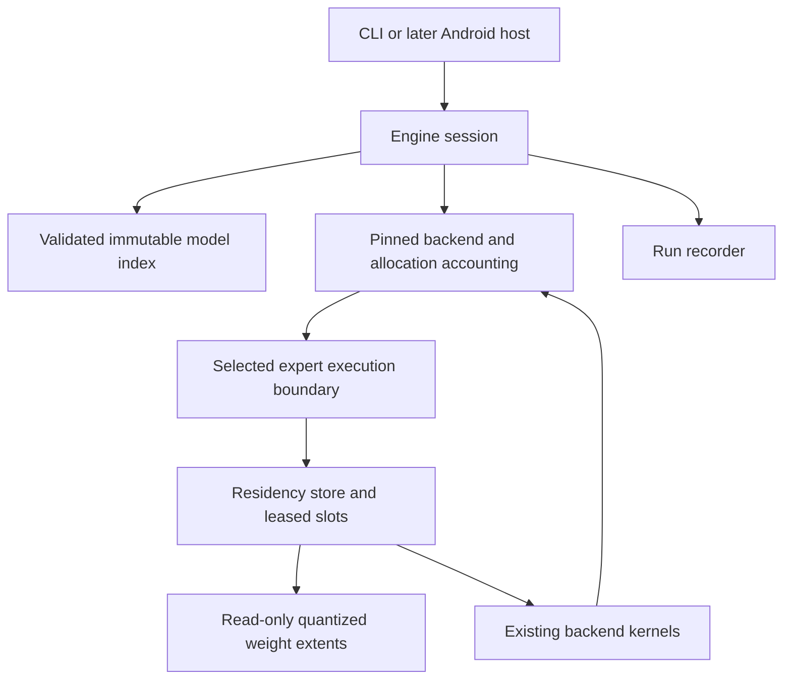

# Architecture

Status: accepted design direction, with source-level feasibility gates still open. No engine implementation exists yet.

## Problem and target

Run exact quantized text inference on the device recorded in [the device profile](../configs/device-vivo-s1-pro.json). Establish a useful small-model baseline, then determine whether a larger MoE model can run with a bounded expert working set backed by internal storage.

Parameter count alone does not answer this question. Shared weights, token embeddings, attention and recurrent state, packed weights, workspaces, thread stacks, and runtime metadata compete with the expert cache. Expert choices also change across layers and tokens.

## Caller experience

These are intended commands, not available binaries:

```sh
ame probe --output runs/device.json
ame inspect --model models/package --config configs/mvp.example.json
ame run --model models/package --config configs/mvp.example.json \
	--prompt-file prompts/input.txt --record-dir runs/one
ame compare --case cases/offload.json --record-dir runs/comparison
```

`probe` reads device capabilities without a serial or private application data. `inspect` computes a model-specific admission plan without loading all expert weights. `run` performs the same validation internally. A caller never coordinates expert reads or eviction.

Proposed C++20 usage:

```cpp
auto engine = Engine::open(package_path, options);
if (!engine) return report(engine.error());
auto outcome = engine.value()->generate(prompt, generation, sink, stop_token);
```

The sketch uses a project-local `Result<T>` value-or-error type. It does not require C++23 `std::expected`. These are new project interfaces, not upstream API names.

## Choose one backend

Use a pinned MNN fork as the first integration candidate. Preserve backend ownership of graph execution, tokenization, model mathematics, and kernels. Keep our patch behind one internal expert-execution boundary. This project owns artifact indexing, memory admission, expert residency, I/O, and lifecycle.

MNN's actual [MoEModule implementation](RESEARCH.md) exposes selected expert IDs before expert submodule calls. Its construction also retains every expert module. Therefore, the first integration experiment must establish lazy construction, releasable backing storage, or another realizable bounded lifetime. A callback that sees routing after all weights are packed is insufficient.

If MNN fails the gate, apply the same gate to pinned llama.cpp before implementing a second production path. Keep only the chosen production backend. An unmodified other backend may remain an external reference. If neither passes, keep the verified small CPU engine and record streaming as blocked.

## Module ownership

The paths below are the intended implementation layout. They do not exist in this scaffold.

| Path | Knowledge and state owned |
| --- | --- |
| `include/ame/engine.hpp` | Public engine, options, token sink, errors, and outcomes. |
| `src/model/` | Immutable validated model index, source identity, extent arithmetic, and quantized layouts. |
| `src/runtime/` | One engine session, memory admission, backend instance, KV and recurrent state, cancellation, and accounting coverage. |
| `src/residency/` | Fixed aligned expert arena, slot index, leases, demand reads, and eviction. |
| `src/backend/` | The selected backend integration and allocation instrumentation. No cache policy. |
| `apps/cli/` | Argument parsing and calls to the public engine. |
| `bench/` | Reference runs, artifact provenance, telemetry, parity, and result aggregation. |
| `patches/` | Small ordered upstream patches against a pinned commit. |

Use CMake and a pinned Android NDK for the host-testable core and ARM64 executable. Resolve the exact available toolchain in phase 0. Pin the selected backend in a machine-readable lock file before its first build. Do not copy an entire backend into this repository for the scaffold.



## Domain contracts

```cpp
struct Bytes { uint64_t value; };
struct TensorId { uint32_t value; };
struct ExpertKey { uint32_t layer; uint32_t expert; };
struct FileExtent { uint32_t file; uint64_t offset; Bytes length; };
struct ExpertTensor {
	TensorId tensor;
	FileExtent extent;
	QuantLayout layout;
};
struct ExpertLayout {
	ExpertKey key;
	std::vector<ExpertTensor> tensors;
	Bytes packed_resident_bytes;
};
struct EngineOptions {
	Bytes owned_memory_limit;
	uint32_t context_tokens;
	uint32_t cpu_threads;
};
struct GenerationOptions { uint32_t max_new_tokens; };
enum class FinishReason { Completed, Cancelled, ContextLimit, ResourceLimit };
struct GenerationResult { FinishReason reason; RunSummary summary; };

class Engine {
public:
	static Result<AdmissionPlan> inspect(Path, const EngineOptions&);
	static Result<std::unique_ptr<Engine>> open(Path, const EngineOptions&);
	Result<GenerationResult> generate(std::string_view prompt,
		GenerationOptions, TokenSink&, std::stop_token);
};

class ExpertLease {
public:
	ExpertLease(ExpertLease&&) noexcept;
	ExpertLease(const ExpertLease&) = delete;
	~ExpertLease();
	std::span<const QuantizedTensorView> views() const;
};
class ResidencyStore {
public:
	Result<ExpertLease> acquire(std::span<const ExpertKey>, std::stop_token);
};
```

`QuantLayout`, `AdmissionPlan`, and views are project domain types whose concrete fields come from the source experiment. Do not export backend tensor pointers or serialized manifest structs through the public API. Include model identity in the cache owner. A per-session store cannot serve another model's offsets.

Only the parser constructs a validated index. Check integer overflow, bounds, split-file identity, quantization block divisibility, stride, alignment, and all format-specific overlap rules. Model files remain immutable while open. Acquire read-only file handles and reject missing or changed files. A converter emits a new derived artifact with original and derived hashes, never an in-place reinterpretation of bytes.

An expert includes every needed projection and quantization parameter, not just one matrix. Shared experts, shared embeddings, routers, and always-used tensors have explicit non-evictable ownership. The model index records whether tensors are fused, strided, transposed, packed, or shared. Unsupported layouts fail import.

## Execute one bounded working set

1. The backend computes routing with unchanged numerical semantics.
2. The integration identifies the exact experts needed for the next compute unit.
3. Residency deduplicates requests and checks the unit's combined live byte requirement.
4. Residency evicts only unleased slots, reserves space, and completes checked demand reads.
5. A move-only lease supplies backend-compatible views. Existing kernels execute in reference order.
6. Release the lease only after all consuming CPU tasks finish. Future accelerator work would require its completion fence.

The first implementation uses demand reads, one I/O operation at a time, and byte-based LRU. No predictor or prefetch worker is needed. Slot metadata and routing arrays are bounded from validated model dimensions. Do not allocate an unbounded map or heap object per generated token.

Use checked `pread` loops. Handle short reads, EINTR, EOF, and errors. A read failure unwinds reservations and pins. Read chunk size bounds the size of a syscall, not how long storage can block it. Check cancellation between reads and compute units, measure cancellation latency, and join outstanding work before destroying buffers.

Admission includes a minimum live set established by the backend experiment. Prefill may select many more experts than one decode token. Use bounded prefill microbatches or serial expert execution only when reference semantics and accumulation order are preserved. Otherwise return `ResourceLimit`; never silently lease all experts or deadlock waiting for space held by the same compute unit. Do not wait for a cache slot when no independent consumer can release one.

## Memory guarantees and their limits

The accounting equation is:

```text
owned peak = retained nonexpert/backend allocations + KV/recurrent state
           + workspace + thread stacks + expert arena + staging
           + metadata + alignment/allocator overhead
```

Reserve the peak live footprint, not just the final steady state. A transient model-load or packing copy can violate the budget before generation starts. Intercept backend allocations or prove equivalent accounting through its allocators. If coverage is incomplete, label it partial and guarantee only the covered arena cap. Do not claim an engine-wide hard cap until the backend coverage gate passes.

`expert_cache_limit` is inside the owned budget. A dense session does not allocate it. Context counts both prompt and generated tokens. Hybrid models require their actual recurrent and attention-state calculation, not a generic KV-only formula.

The example budget is a hypothesis, not a known optimum. Admission uses a fresh memory observation, explicit system headroom, the artifact's minimum live set, and measured fixed backend overhead. Return a reasoned refusal when these do not fit.

Report owned reservations separately from RSS, PSS, file-backed mappings, and system memory. Buffered reads can populate the OS page cache while also filling our arena. mmap can fault additional pages. Neither OS page cache nor Android's total process memory is controlled by the arena cap. There is no root-only cache drop or guaranteed immunity from Android process termination.

## Storage and runtime state

For the first working model, use the selected backend's native verified artifact format. A small sidecar manifest indexes checked extents and records provenance. Avoid a new universal model format. Repack expert projections only after direct extent access passes and evidence shows layout is limiting performance.

Perform storage admission before download, conversion, transfer, or repack. Include source files, converted artifacts, temporary output, backend disk caches, and reserved free space. Hash outside timed phases. Publish derived files with temporary names and an atomic rename only after verification.

One `Engine` owns one active generation, backend state, sampler, cache, and recorder. A second concurrent `generate` returns `Busy`. Cross-thread cancellation may request stop; cache mutation remains on the inference owner. A failed or cancelled partially evaluated generation destroys its request state before reuse. Repeated independent prompts begin with fresh KV, recurrent state, and RNG state.

The CLI records start, partial progress, and a final outcome. A supervisor classifies an absent final record as interrupted or unknown, not successful. A later Android host forwards lifecycle and memory-pressure events into cancellation. Implement CPU cancellation and cleanup before JNI or an app service.

## Expansion gates

GPU, NNAPI, QNN, multimodal input, predictive prefetch, KV offload, and multi-session serving are deferred. Each needs a separate measured justification. GPU shares physical RAM, and modern accelerator examples do not establish support on SM6125. Keep Android thermal protections intact.

The [implementation plan](IMPLEMENTATION_PLAN.md) defines the proof required before each expansion.
