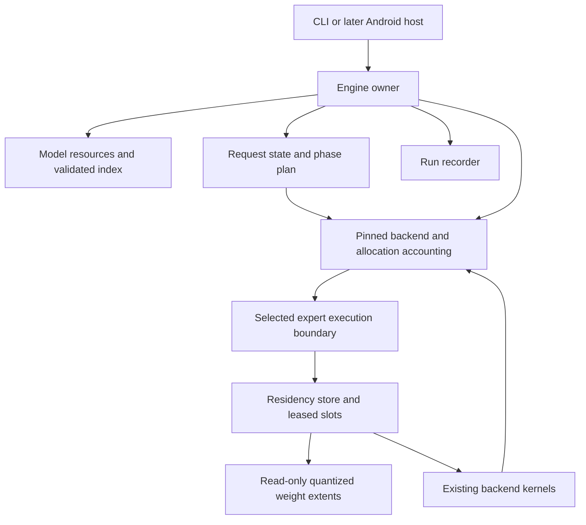

# Architecture

Status: accepted design direction. A host coding foundation, a read-only device probe, a bounded residency store, and a verified llama.cpp text baseline exist. A small runtime patch materializes selected experts into the project arena, and a real 14.3B MoE fixture completed storage-backed decode on the phone. The pinned NDK cross-build runs on the physical phone. See [phase 0](IMPLEMENTATION_PLAN.md#phase-0-evidence-2026-10-19), [phase 1](IMPLEMENTATION_PLAN.md#phase-1-evidence-2026-10-19), and [the feasibility report](backend-feasibility.md). A real 35B target ran at contexts 512, 1024, and 2048 with about 2.06-2.09 GiB peak RSS and a 28-38 MB arena. Unit 1 now has structured multi-worker failure and conservative-prefill evidence; there is still no hard engine memory cap, no full-resident reference parity, and no changed-microbatch parity.

## Problem and target

Run exact quantized text inference on the device recorded in [the device profile](../configs/device-vivo-s1-pro.json). Establish a useful small-model baseline, then determine whether a larger MoE model can run with a bounded expert working set backed by internal storage.

Parameter count alone does not answer this question. Shared weights, token embeddings, attention and recurrent state, packed weights, workspaces, thread stacks, and runtime metadata compete with the expert cache. Expert choices also change across layers and tokens.

## Caller experience

These are intended commands, not available binaries:

```sh
ame probe --output runs/device.json
ame inspect --model models/package --config configs/mvp.example.json
ame run --model models/package --config configs/mvp.example.json \
	--prompt-file prompts/input.txt --record-dir runs/one
ame compare --left runs/run-01.json --right runs/run-02.json
```

`probe` reads device capabilities without a serial or private application data. `inspect` computes a model-specific admission plan without loading all expert weights. `run` performs the same validation internally. A caller never coordinates expert reads or eviction.

Proposed C++20 usage:

```cpp
auto engine = Engine::open(package_path, options);
if (!engine) return report(engine.error());
auto outcome = engine.value()->generate(prompt, generation, sink, cancellation);
```

The sketch uses a project-local `Result<T>` value-or-error type and a project-owned `Cancellation` token. The pinned NDK's libc++ does not expose `std::stop_token`, so the internal boundary must not depend on it. The sketch does not require C++23 `std::expected`. These are new project interfaces, not upstream API names.

## Choose one backend

Use pinned llama.cpp as the provisional production backend after the phase 1 gate. Preserve backend ownership of graph execution, tokenization, model mathematics, and kernels. Keep our patch behind one internal expert-execution boundary. This project owns artifact indexing, memory admission, expert residency, I/O, and lifecycle.

MNN remains an inspected alternative, not a second production path. Its [MoEModule implementation](RESEARCH.md) exposes selected expert IDs before expert submodule calls, but its construction retains every expert module and offers no per-expert release path. It failed the bounded-lifetime gate and is not built here.

The llama.cpp gate is kernel-boundary evidence, not an integrated stream. [`ggml_compute_forward_mul_mat_id`](https://github.com/ggml-org/llama.cpp/blob/ff5a23376725e5a889fa0bfb987b7541dc304da0/ggml/src/ggml-cpu/ggml-cpu.c#L1554) reads each selected expert plane, and the result shape does not depend on the number of experts in the weight tensor. [The gate](backend-feasibility.md) showed that remapping selected IDs to a compact arena is bitwise exact on host and phone. The runtime materializer patch now intercepts the expert tensor at the real CPU `MUL_MAT_ID` boundary and supplies a compact arena-backed view. A real 14.3B MoE fixture completed with identical tokens across seven runs and about 1.2 GiB peak RSS after mmap prefetch was disabled. This is a proven mechanism, not a hard memory cap. The 35B target later ran with identical tokens across three context-512 runs and about 2.06 GiB peak RSS, but the LRU cache still did not reuse across tensor switches. The Unit 1 materializer returns explicit pass-through, staged, cancelled, or failed outcomes; failures latch and abort the graph instead of returning resident data. Do not describe the engine as a completed 35B streaming implementation.

[LiteRT-LM and AirLLM research](UPSTREAM_DESIGNS.md) strengthens these contracts without adding production adapters. LiteRT-LM's resource and execution boundaries are useful; whole-section streaming does not prove expert eviction. Current AirLLM demonstrates conditional expert-module loading, but its layout and framework assumptions do not establish support for our native backend or selected models.

## Module ownership

The table distinguishes implemented foundation code from planned modules. No public engine SDK is installed.

| Path | Knowledge and state owned |
| --- | --- |
| `include/ame/engine.hpp` (planned, absent) | Public engine, options, token sink, errors, and outcomes after source gates. |
| `src/model/` (partial) | Internal checked extent arithmetic exists. Index, identity, and quantized layouts remain planned. |
| `src/runtime/` | One engine session, memory admission, backend instance, KV and recurrent state, cancellation, and accounting coverage. |
| `src/residency/` (store implemented) | Fixed aligned expert arena, slot index, move-only leases, demand reads, byte-based LRU, and cancellation. Tested with sparse files above 4 GiB. |
| `src/backend/` (prototype) | llama.cpp is the provisional production backend. A runtime materializer, a manifest-driven arena, two small upstream patches, structured multi-worker failure outcomes, and a conservative prefill plan exist. Allocation instrumentation, a shared per-tensor cache, and changed-microbatch parity do not. |
| `src/probe/` (implemented) | Read-only host/Android observation of memory, CPU, storage, OS, thermal, and power state. No device profile inference and no performance claim. |
| `apps/cli/` (foundation) | Help/version, invalid-argument diagnostics, and `ame probe`. Engine calls remain planned. |
| `bench/` | Reference runs, artifact provenance, telemetry, parity, and result aggregation. |
| `patches/` | Small ordered upstream patches against a pinned commit. |

Runtime and backend integration remain planned; residency now contains checked file sources, a fixed arena, leases, and eviction, and bench contains the baseline harness and expert-remap gate. Upstream patches remain empty. `CheckedFileExtent::within` returns a checked value or a small error enum. It accepts empty extents including EOF and checks length against `file_size - offset` only after checking offset. It proves no tensor layout or file identity contract. See [coding rules](CODING.md).

The probe records raw observations. It does not interpret thermal-zone sentinels or unavailable power-supply nodes, and it does not turn a snapshot into a reservation. Its host mode reports `execution_tag: host`; only an on-Android run reports `physical_target`, and an Android property that marks an emulator reports `emulator`.

Use CMake and a pinned Android NDK for the host-testable core and ARM64 executable. Resolve the exact available toolchain in phase 0. Pin the selected backend in a machine-readable lock file before its first build. Do not copy an entire backend into this repository for the scaffold.



## Domain contracts

```cpp
struct Bytes { uint64_t value; };
struct TensorId { uint32_t value; };
struct ExpertKey { uint32_t layer; uint32_t expert; };
struct FileExtent { uint32_t file; uint64_t offset; Bytes length; };
struct ExpertTensor {
	TensorId tensor;
	FileExtent extent;
	QuantLayout layout;
};
struct ExpertLayout {
	ExpertKey key;
	std::vector<ExpertTensor> tensors;
	Bytes packed_resident_bytes;
};
struct EngineOptions {
	Bytes owned_memory_limit;
	uint32_t context_tokens;
	uint32_t cpu_threads;
};
struct GenerationOptions { uint32_t max_new_tokens; };
enum class FinishReason { Completed, Cancelled, ContextLimit, ResourceLimit };
struct GenerationResult { FinishReason reason; RunSummary summary; };

class Engine {
public:
	static Result<AdmissionPlan> inspect(Path, const EngineOptions&);
	static Result<std::unique_ptr<Engine>> open(Path, const EngineOptions&);
	Result<GenerationResult> generate(std::string_view prompt,
		GenerationOptions, TokenSink&, const Cancellation&);
};

class ExpertLease {
public:
	ExpertLease(ExpertLease&&) noexcept;
	ExpertLease(const ExpertLease&) = delete;
	~ExpertLease();
	std::span<const QuantizedTensorView> views() const;
};
class ResidencyStore {
public:
	Result<ExpertLease> acquire(std::span<const ExpertKey>, const Cancellation&);
};
```

`QuantLayout`, `AdmissionPlan`, and views are project domain types whose concrete fields come from the source experiment. Do not export backend tensor pointers or serialized manifest structs through the public API. Include model identity in the cache owner. A per-session store cannot serve another model's offsets.

The source review adds private planning records at the existing module boundaries. These are design types, not new public APIs or claims about upstream interfaces:

```cpp
struct BackendCapabilities {
	PrefillSupport prefill;
	WeightLifetimeSupport expert_lifetime;
	AccountingCoverage allocations;
};
struct RequestPlan {
	PrefillPlan prefill;
	StateAllocationPlan state;
	PhaseReservations load, prefill_peak, decode_peak;
};
struct TensorStorageGroup {
	StorageId storage;
	std::vector<TensorId> aliases;
	WeightOwnership owner;
	MaterializationPlan materialization;
};
```

`src/backend/` supplies evidence for the exact artifact's capabilities. `src/model/` owns validated storage groups. `src/runtime/` derives the request plan and owns reservations. No new generic executor or plugin framework is needed. Unknown capability is not supported capability.

## Keep model resources and request state distinct

An engine instance owns validated artifact metadata, read-only file handles, tokenizer resources, and its backend execution instance. Each generation owns fresh token positions, KV/recurrent state, sampler/RNG state, phase, cancellation, and metrics. A backend that retains these internally still counts their allocations; conceptual separation cannot hide bytes.

Keep the existing per-session residency store and one active generation. Immutable metadata does not make an executor thread safe or permit requests to share mutable cache/state. Normal independent generations may retain weight-cache contents only under a declared warm-cache policy. They always reset request-local numerical state.

Teardown order is execution admission stop, completion/drain of consumers and reads, lease release, request-state destruction, backend destruction when required, then backing model resources. Cancellation or a partial compute failure makes the request unusable. A subsequent request needs a proven safe backend reset; otherwise close and recreate the execution instance before reuse. A stop flag alone does not establish completion.

## Validate weight storage

Only the parser constructs a validated index. Check integer overflow, bounds, split-file identity, quantization block divisibility, stride, alignment, and all format-specific overlap rules. Model files remain immutable while open. Acquire read-only file handles and reject missing or changed files. A converter emits a new derived artifact with original and derived hashes, never an in-place reinterpretation of bytes.

An expert includes every needed projection and quantization parameter, not just one matrix. Shared experts, shared embeddings, routers, and always-used tensors have explicit non-evictable ownership. The model index records whether tensors are fused, strided, transposed, packed, or shared. Unsupported layouts fail import.

Give aliased tensors one canonical backing-storage identity and explicit view lifetimes. Charge one shared allocation once, and every real packed or copied allocation separately. Distinguish persistent children, tied input/output embeddings, shared experts, and leased expert tensors. Release only storage owned by the completed unit. Recursive parent unloading must not destroy persistent children or leave stale aliases.

## Plan prefill and decode from real capabilities

Before materialization, validate required CPU operators, native artifact version, state tensors, quantization companions, and available prefill/decode signatures. Derive allowed prefill chunks from the actual backend and artifact. Some exports support dynamic chunks, others only declared shapes or full-prompt execution. An expert microbatch within a layer also needs separate proof; token chunking alone does not bound its expert union.

The backend owns pending-input-token, position, attention, recurrent-state, and accumulation conventions. The project does not implement a second generation loop that guesses these conventions. `inspect` reports validated model/context admission and named unknowns. After backend tokenization, `generate` checks the actual prompt length and exact phase plan before allocating request state. An unsupported or over-budget plan refuses execution without silently changing context or schedule.

Admission records the load peak, prefill peak, and decode peak. Include metadata-derived state banks and growth transitions, such as old and new buffers alive together. Do not assume every backend is stateless, every state tensor is a K/V pair, or a smaller steady-state cache removes its allocation-time peak.

## Execute one bounded working set

1. The backend computes routing with unchanged numerical semantics.
2. The integration identifies the exact experts needed for the next compute unit.
3. Residency deduplicates requests and checks the unit's combined live byte requirement.
4. Residency evicts only unleased slots, reserves space, and completes checked demand reads.
5. A move-only lease supplies backend-compatible views. Existing kernels execute in reference order.
6. Release the lease only after all consuming CPU tasks finish. Future accelerator work would require its completion fence.

The first implementation uses demand reads, one I/O operation at a time, and byte-based LRU. No predictor or prefetch worker is needed. Slot metadata and routing arrays are bounded from validated model dimensions. Do not allocate an unbounded map or heap object per generated token.

AirLLM's selective loading suggests an exact tensor-subset boundary, not a name-based compatibility shortcut. The chosen native layout must expose every selected expert projection and companion before packing. A fused expert tensor needs validated slicing and kernel views; without them, refuse streaming instead of loading the full expert bank beyond admission.

Use checked `pread` loops. Handle short reads, EINTR, EOF, and errors. A read failure unwinds reservations and pins. Read chunk size bounds the size of a syscall, not how long storage can block it. Check cancellation between reads and compute units, measure cancellation latency, and join outstanding work before destroying buffers.

Admission includes a minimum live set established by the backend experiment. Prefill may select many more experts than one decode token. Use bounded prefill microbatches or serial expert execution only when reference semantics and accumulation order are preserved. Otherwise return `ResourceLimit`; never silently lease all experts or deadlock waiting for space held by the same compute unit. Do not wait for a cache slot when no independent consumer can release one.

## Memory guarantees and their limits

The accounting equation is:

```text
owned peak = retained nonexpert/backend allocations + KV/recurrent state
           + workspace + thread stacks + expert arena + staging
           + metadata + alignment/allocator overhead
```

Reserve the peak live footprint, not just the final steady state. A transient model-load or packing copy can violate the budget before generation starts. Intercept backend allocations or prove equivalent accounting through its allocators. If coverage is incomplete, label it partial and guarantee only the covered arena cap. Do not claim an engine-wide hard cap until the backend coverage gate passes.

For every storage group, record stored representation, materialized dtype/size, packing behavior, and retained copies. Compression on disk is not proof of native low-bit compute. Reserve overlapping packed input, decompressed output, staging, state growth, and workspace before materialization. A fallback from pinned to pageable memory or to whole-section loading must pass the same admission check.

`expert_cache_limit` is inside the owned budget. A dense session does not allocate it. Context counts both prompt and generated tokens. Hybrid models require their actual recurrent and attention-state calculation, not a generic KV-only formula.

The example budget is a hypothesis, not a known optimum. Admission uses a fresh memory observation, explicit system headroom, the artifact's minimum live set, and measured fixed backend overhead. Return a reasoned refusal when these do not fit.

Report owned reservations separately from RSS, PSS, file-backed mappings, and system memory. Buffered reads can populate the OS page cache while also filling our arena. mmap can fault additional pages. Neither OS page cache nor Android's total process memory is controlled by the arena cap. There is no root-only cache drop or guaranteed immunity from Android process termination.

## Storage and runtime state

For the first working model, use the selected backend's native verified artifact format. A small sidecar manifest indexes checked extents and records provenance. Avoid a new universal model format. Repack expert projections only after direct extent access passes and evidence shows layout is limiting performance.

The sidecar declares its schema version, native artifact/converter identities, section roles, tensor/storage groups, and materialization requirements. Read bounded metadata without loading every tensor payload during inspection. Validate format alignment, runtime page size, and kernel tensor alignment independently. Native external sections or chunked model delivery do not imply expert-level eviction or zero-copy execution.

Reuse an existing native shard or file extent when immutable identity is verified. Resume derived-artifact preparation only when source hashes, converter identity, and options match. Verify staged output and publish its manifest atomically after its referenced files are complete. A `.done` marker or file existence alone is insufficient; source files are preserved.

Perform storage admission before download, conversion, transfer, or repack. Include source files, converted artifacts, temporary output, backend disk caches, and reserved free space. Hash outside timed phases. Publish derived files with temporary names and an atomic rename only after verification.

One `Engine` owns one active generation, its backend instance, cache, and recorder. A second concurrent `generate` returns `Busy`. Cross-thread cancellation may request stop; cache mutation remains on the inference owner. The request-lifetime contract above governs cleanup and reset. Repeated independent prompts begin with fresh KV, recurrent state, and RNG state.

The CLI records start, partial progress, and a final outcome. A supervisor classifies an absent final record as interrupted or unknown, not successful. A later Android host forwards lifecycle and memory-pressure events into cancellation. Implement CPU cancellation and cleanup before JNI or an app service.

## Expansion gates

GPU, NNAPI, QNN, multimodal input, predictive prefetch, KV offload, and multi-session serving are deferred. Each needs a separate measured justification. GPU shares physical RAM, and modern accelerator examples do not establish support on SM6125. Keep Android thermal protections intact.

Whole-layer streaming is a deferred dense-model comparison, not the expert-streaming MVP or a way to bypass its live-set gate. Any later next-unit prefetch must reserve current leases, next-unit bytes, packing/expansion, state, and workspace simultaneously, and prove cancellation/join cleanup. Neither a single worker nor a pinned-copy threshold is a total-memory bound.

The [implementation plan](IMPLEMENTATION_PLAN.md) defines the proof required before each expansion.
## Structured materializer outcomes (Unit 1, 2026-10-19)

The materializer contract distinguishes resident pass-through, staged success,
cancellation, and failure. Thread 0 publishes the outcome before the existing worker
barrier, so all workers select the same branch. A latched failure causes the CPU graph
loop to stop before later nodes consume incomplete output; the harness abort callback
observes the same state and `llama_decode` returns 2. Expected storage, arena,
capacity, metadata, and unindexed-expert failures are structured; they no longer call
`std::abort()`. A failed request requires reopen.

The conservative prefill plan derives expert count and top-k from model metadata and
sets `n_ubatch` before context construction. Its union bound is
`min(expert_count, tokens_per_unit * top_k)`, also capped by slots, the 128-expert
lease limit, and checked arithmetic. For 256 experts, top-8, and 64 slots, one compute
unit is eight tokens. Configurations below top-k refuse before decode. See
[the Unit 1 report](UNIT1_REPORT.md).
## Verified artifact identity (Unit 2, 2026-10-19)

Verified streaming opens one read-only artifact FD, checks its byte count, computes
a full SHA-256 over that FD, and compares it to an independently enrolled digest.
The same FD's `/proc/self/fd` path is used by the backend loader, and every expert
size-class source duplicates that FD. The manifest is validated against the parsed
GGUF tensor table: name, type, complete dimensions, absolute offset, extent, stride,
quantization row arithmetic, and complete routed-tensor coverage. A manifest cannot
legitimize a wrong in-bounds offset because the GGUF table is authoritative.

The engine rechecks the retained inode's size/device/inode/mtime before installation
and before every materialization. This catches truncation and ordinary in-place writes
that change metadata; it is not runtime content authentication. A byte write between
a recheck and a bounded read, or one that preserves metadata, can still be consumed.
The expected digest is the trust root and must come from the pinned artifact record,
not from the manifest. Full-hash startup cost is measured separately and is currently
a release blocker on the phone. See [the Unit 2 report](UNIT2_REPORT.md).

## Native HTTP API (2026-10-19)

`apps/server/main.cpp` is a native ARM64 HTTP server over the pinned llama.cpp
model, tokenizer, chat template, sampler, and the project's verified artifact and
materializer path. It serves `/health`, `/v1/models`, and OpenAI-compatible
`/v1/chat/completions` JSON/SSE. Each request creates and destroys its own llama
context; the model object and verified artifact FD remain alive. One generation is
admitted at a time. The API does not implement tools, vision, audio, or complete
OpenAI parity.

Dense Qwen3.5-2B and streamed Qwen1.5-MoE were exercised on the phone. See
[RUN_PHONE.md](RUN_PHONE.md) and [RELEASE_RECORD.json](RELEASE_RECORD.json).

The 35B text path now uses the pinned upstream `common_chat_templates` Jinja
renderer over the model's stored template, with `enable_thinking=false` by
default. A private server helper preserves origin-marked prompt parts and the
model's BOS/EOS policy during upstream tokenization. Each request owns its token
vector before entering generation. Template and model owners outlive the HTTP
server. Streaming cleanup then clears saved consumer bindings and stores without
dereferencing the released model; the artifact FD remains open through that
cleanup. The loading listener
has scope-owned stop/join on C++ failure paths. These changes do not alter model
mathematics, routing, or the expert materializer contract. The enrolled 35B phone
JSON/SSE smoke and its timing limits are recorded in [RUN_35B.md](RUN_35B.md).
