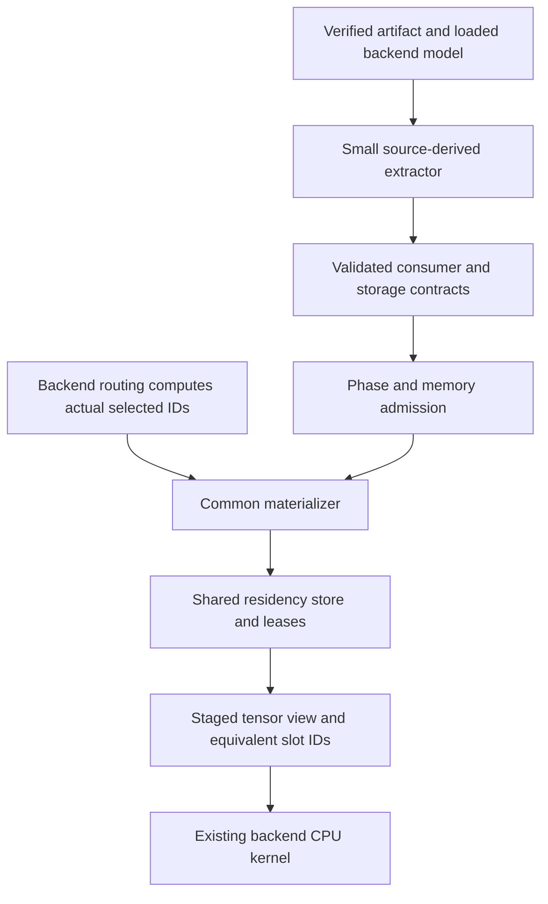

# Generalize MoE storage across backend-supported architectures

Date: 2026-10-19. Status: proposed internal contract and implementation handoff. No new architecture support is established by this document. Active Unit 3 source and evidence changes are outside this design unit.

## Goal and caller experience

Keep one pinned llama.cpp executor and one reusable expert-storage core. Accept models through their validated operator and storage capabilities rather than a Qwen-specific execution path or a new backend per family.

The user selects an artifact and a memory budget. Inspection reports whether its exact layout and requested phase can stream, with a precise reason for refusal. Generation uses that same admitted contract. The caller does not select an expert axis, tensor-name pattern, or family-specific cache implementation.

The existing `ame run` remains a supervisor. A future model-facing inspect/open/generate interface remains proposed; this design does not claim those APIs or commands already exist.

## Current execution and assumptions

The indexer discovers expert weights using GGUF names, derives expert extents, and produces a manifest. The verified artifact supplies the backing identity and authoritative tensor table. At the patched CPU `MUL_MAT_ID`, the materializer consumes IDs computed by llama.cpp, acquires expert leases, and redirects the operation to a compact arena-backed view with equivalent slot IDs. Workers finish before backing is released. Routing weights, attention, recurrent state, and numerical kernels stay upstream.

The current implementation has assumptions to make explicit:

- `tools/gguf_index.py` uses `blk.*` and expert-name patterns, requires three-dimensional expert weights, and treats dimension two as the expert axis.
- `src/backend/moe_stream.cpp` validates contiguous planes through `ne[2]` and `nb[2]`, uses two-dimensional I32 selected IDs, and partitions arenas by expert payload size.
- `bench/llama_baseline.cpp` reads scalar model-wide expert count and top-k metadata.
- `src/runtime/prefill_plan.*` plans from those scalars and a fixed lease limit.
- `src/residency/store.*` supports equal-sized slots per pool and move-only leases. That useful implementation can serve multiple architectures without being replaced.

These describe one proven representation. They do not describe every possible MoE graph.

## Reuse upstream semantic discovery

The pinned backend already distinguishes expert roles through `llama_layer` fields. Its static `llama_moe_cache_layer_experts` helper in `src/llama-moe-cache.cpp` enumerates separate gate/up/down or fused gate-up/down projections. `src/llama-graph.cpp` builds the routed operations, while `src/models/qwen2moe.cpp` and `src/models/qwen35moe.cpp` provide different model graphs using shared MoE machinery.

Reuse that source knowledge through a small, identified backend extraction boundary. The static helper is not an existing public API. Exporting or adapting it requires an explicit patch and tests. Its current cache uploads host-resident experts to a device and is not a ready-made CPU disk-streaming engine.

Likewise, reuse `tests/test-llama-archs.cpp` for small model generation and architecture fixtures. Adapt the fixtures for quantized storage and streaming coverage rather than implementing another model generator.

## Share a contract for each expert consumer

Use one immutable validated streaming contract. Architecture-specific source knowledge is confined to extraction. It does not implement routing, cache replacement, memory policy, or generation.

The following are conceptual internal records, not implemented upstream APIs or a public SDK:

| Record | Required knowledge |
| --- | --- |
| Artifact binding | Exact enrolled identity, retained backing object, tensor table, backend and patch identities, and integrity coverage. |
| Expert table | Stable table ID, canonical backing identity, expert cardinality, complete quantization representation, checked dimensions and strides, and stored/materialized byte sizes. |
| Consumer contract | Bound backend operator, expert table/view identity, selected-ID type and shape, maximum selections per token, required companion tensors, and supported layout. |
| Resident backing | Shared experts, routing weights, aliases, persistent children, and other weights with explicit ownership and accounting. |
| Phase plan | Covered prefill/decode operator paths, safe microbatch limit, per-pool reservations, backend state/workspace treatment, and precise unsupported reasons. |

Cache keys identify artifact, table, and expert. A table ID is not a model layer number. Several projections can belong to one layer, and aliases can refer to shared canonical backing.

Initially the layout variant is only contiguous uniform expert planes compatible with the existing CPU consumer. An arbitrary expert-axis field does not make transpose, gather, fused packing, or interleaved quantization supported. Introduce each new layout only after a concrete artifact requires it and its view/materialization has parity and lifetime evidence.

Shared experts may remain resident in the first implementation, but their bytes must count. Fused gate-up is a separate tested capability, including its backend views and aliases. Auxiliary scales must be identified and owned; never silently omit an unfamiliar companion tensor.

Every required routed consumer must be accounted for before streaming admission. Validate runtime consumers against their bindings as defense in depth. An unrecognized expert path is a failure, not resident fallback. Dense operations pass through only under their declared resident execution contract. Source inspection must cover conditional paths that a short warm-up may not exercise.

## Plan capacity per consumer

For consumer `i` with expert cardinality `E_i`, source-proven maximum selected experts per token `K_i`, and effective token unit `B`, use the conservative bound `min(E_i, B * K_i)`. Check overflow and compare it to that consumer's pool capacity and lease limit.

The safe common unit is constrained by every participating consumer and the backend's legal phase shapes. For uniform top-8 routing, 256 experts, and 64 slots, eight tokens is one conservative case. It is not a universal MoE constant. Unknown or variable selection without a proven bound must refuse.

Keep fixed-size pools initially. Charge the sum of simultaneously retained pools, not just the largest expert tensor. Include metadata, remapped IDs, alignment, staging, packing, resident weights, and state/workspace coverage. Heterogeneous expert sizes across tables can use separate existing pools. Arbitrary variable-size experts within a table remain unsupported until a separate allocator/layout gate passes.

This contract does not close the current writable-backing integrity gap, establish a hard process cap, or prove changed-microbatch parity. Preserve each limit in telemetry and admission.

## Demonstrate generality with different graphs

| Test target | What it establishes if its gates pass |
| --- | --- |
| Ordinary transformer MoE, initially a source-supported Qwen2MoE fixture | Separate routed projections, shared experts, standard attention, and common storage behavior. |
| Hybrid recurrent-attention MoE, initially the existing qwen35moe fixture work | Reuse of the same storage core while backend-owned recurrent state and attention follow their own phase contracts. |
| A later non-Qwen architecture supported by the pin | Tests that discovery and eligibility do not merely duplicate Qwen assumptions. Select from inspected upstream fixtures and an executable small reference. |

These are coverage targets, not support declarations. Grouped routing can reuse this core if the backend still supplies compatible final selected IDs, but that condition requires source and numerical evidence. Supporting a family name never establishes support for all quantizations, fused forms, shards, architectures, or phases.

Keep exact candidate identity and support status in `configs/model-candidates.json`. Derive runtime capabilities from validated contracts instead of maintaining another hand-synchronized support registry.

## Migrate in small units

1. Finish or checkpoint the active Unit 3 work. Preserve its complete-model comparisons as regression oracles.
2. Inventory current artifact and graph assumptions. Add a read-only contract extractor for the currently accepted contiguous-plane path. Compare its facts and refusals against existing fixtures without broadening support.
3. Make manifest verification, materialization, and prefill consume that contract. Migrate callers together and remove duplicate expert-discovery rules. Do not leave a name-based fallback path that silently grants support.
4. Exercise the ordinary and hybrid fixtures through the same code. Add the non-Qwen fixture before claiming broad architecture generality.
5. Admit new layouts or consumers individually, only after their complete tests. Keep unsupported reasons actionable.

Each implementation unit needs identity/layout negatives, complete consumer coverage, quantized projection and full-graph reference comparisons, matched phase settings, changed-microbatch evidence when offered, boundary refusal, cancellation/drain/reopen, and pool-accounting evidence. Physical-target results remain specific to the tested artifact, build, and configuration. Dense-path regression is required too.

## Design choice and reconciliation

Three independent design sketches compared per-operator contracts, architecture-profile dispatch, and a broader universal storage plan. Independent cross-review selected the narrow per-operator contract as the base. The alternatives were assessed on backend reuse, interface depth, resource/lifetime contracts, cross-architecture evidence, and safe migration.

The architecture-profile candidate contributed an explicit source-derived extraction owner and complete routed-site coverage. The broader plan contributed later alias, shard, companion, and transition-peak evidence gates. A runtime family-plugin framework, immediate variable-extent repacking, and allocator replacement were rejected because they expand unproven behavior without being necessary for two different model graphs.

The Model the Domain principle shaped the choice of one validated contract rather than scattered model-name conditionals. This document proposes the contract only. Update `docs/ARCHITECTURE.md` and `docs/DESIGN_DECISION.md` when an implementation and its source gates establish the final form. No production interfaces were changed in this unit.

## Implementation handoff

> Generalize the existing MoE streaming integration using `docs/MOE_GENERALIZATION.md`. Start after the active Unit 3 implementation reaches a checkpoint. Reuse pinned llama.cpp model semantics, expert-role discovery, and synthetic model fixtures. First implement a validated internal consumer/storage contract for the currently supported contiguous expert planes, preserving behavior and existing failure cases. Make indexing, materialization, and phase planning consume that contract. Demonstrate the same core on ordinary transformer-MoE and hybrid recurrent-attention fixtures, then add one source-supported non-Qwen fixture. Do not implement routing, add another backend, introduce a plugin framework, or claim unsupported layouts work. Keep candidate support exact and evidence-based. Deliver reviewable commits, complete-model parity, failure/lifetime checks, and precise unsupported reasons. Leave active work by other agents untouched and use isolated worktrees when necessary.
