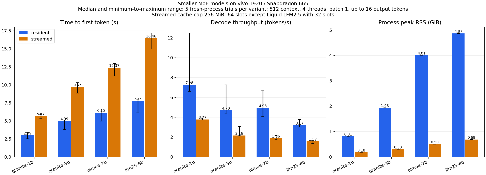

# Smaller MoE models on the physical phone

All four Q4_K_M artifacts completed resident and streamed CPU inference on a vivo 1920 with Snapdragon 665. All 28 matched pairs produced identical prompt IDs, output IDs, output text, and finish reasons. All eight captured-logit comparisons matched byte for byte.

This campaign contains 56 fresh-process trials. For each model, one warmup pair precedes five alternating measured pairs, followed by one distinct-prompt pair. The table excludes warmup and distinct-prompt trials. Values are median [minimum, maximum], with five measured trials per mode.

## Latency, throughput, and peak memory

| Model | Mode | TTFT, seconds | Decode, tokens/s | Peak RSS, GiB |
| --- | --- | ---: | ---: | ---: |
| granite-1b | resident | 2.99 [2.52, 3.36] | 7.28 [6.61, 12.49] | 0.81 [0.81, 0.82] |
| granite-1b | streamed | 5.67 [5.30, 5.86] | 3.77 [3.73, 3.93] | 0.18 [0.18, 0.19] |
| granite-3b | resident | 4.99 [3.79, 5.10] | 4.70 [4.40, 7.27] | 1.93 [1.93, 1.94] |
| granite-3b | streamed | 9.67 [8.83, 10.29] | 2.16 [2.13, 3.07] | 0.30 [0.30, 0.31] |
| olmoe-7b | resident | 6.15 [4.96, 6.25] | 4.93 [4.06, 6.67] | 4.01 [4.01, 4.02] |
| olmoe-7b | streamed | 12.37 [11.22, 12.94] | 1.86 [1.77, 2.16] | 0.50 [0.50, 0.51] |
| lfm25-8b | resident | 7.75 [6.20, 7.99] | 3.17 [3.02, 3.76] | 4.87 [4.87, 4.88] |
| lfm25-8b | streamed | 16.46 [14.96, 17.17] | 1.57 [1.33, 1.68] | 0.69 [0.69, 0.71] |

Resident mode was faster for all four artifacts under these settings. Streaming reduced peak RSS but increased TTFT and reduced decode throughput. Granite 1B is the smallest tested resident baseline. These results do not rank response quality.

## What was compared

- Context 512, four requested CPU threads, matched one-token prefill microbatches, greedy sampling, seed 1234, and up to 16 generated tokens. GPU layers are zero.
- The primary prompt asks for a short explanation of why the sky appears blue. The distinct prompt asks how plants use sunlight to grow. The exact prompts are in the protocol summary.
- The resident reference uses the same pinned patched backend with the materializer disabled. It is not a pristine unpatched upstream reference. Each shipped mode retains its own CPU extra-buffer selection.
- Every pair checks exact prompt IDs, output IDs, output bytes, runtime configuration, and finish reason. Full captured float-logit bytes are compared for the first measured pair and the distinct-prompt pair. This does not establish logit parity for every trial.
- Every model is verified by SHA256 on the host and phone. The streamed process additionally verifies its retained artifact descriptor before inference.

## Cache configuration and startup

The expert arena cap is 256 MiB. Granite and OLMoE use 64 slots. Liquid uses 32 slots under a pre-run metadata amendment. Its two expert-size classes require 309.75 MiB at 64 slots, exceeding that cap. At 32 slots they require 154.875 MiB. No failed 64-slot Liquid inference was run. The declared 1,048,576 KiB system-memory floor was unchanged, and all observed trials passed it.

| Model | Mode | Load, seconds | Prefill, seconds | Generate, seconds | Harness wall, seconds | Stream hashing, seconds |
| --- | --- | ---: | ---: | ---: | ---: | ---: |
| granite-1b | resident | 0.39 [0.39, 0.39] | 2.99 [2.52, 3.36] | 5.05 [3.72, 5.59] | 5.45 [4.12, 5.99] | Not measured |
| granite-1b | streamed | 0.33 [0.32, 0.49] | 5.67 [5.29, 5.86] | 9.53 [9.27, 9.84] | 17.71 [16.61, 18.16] | 7.90 [6.59, 7.96] |
| granite-3b | resident | 0.53 [0.52, 0.53] | 4.98 [3.78, 5.09] | 7.87 [7.05, 8.42] | 8.40 [7.58, 8.96] | Not measured |
| granite-3b | streamed | 0.35 [0.35, 0.73] | 9.67 [8.83, 10.29] | 16.56 [15.10, 16.82] | 35.34 [34.22, 37.31] | 18.71 [18.24, 19.97] |
| olmoe-7b | resident | 0.95 [0.69, 0.96] | 6.14 [4.95, 6.25] | 8.87 [7.78, 9.90] | 9.58 [8.75, 10.85] | Not measured |
| olmoe-7b | streamed | 0.32 [0.32, 0.37] | 12.37 [11.22, 12.94] | 19.55 [19.32, 21.06] | 60.10 [57.59, 61.38] | 39.81 [37.85, 40.18] |
| lfm25-8b | resident | 2.06 [1.80, 2.08] | 7.75 [6.19, 7.98] | 11.74 [10.77, 12.72] | 13.79 [12.59, 14.80] | Not measured |
| lfm25-8b | streamed | 1.36 [1.20, 1.38] | 16.46 [14.96, 17.17] | 26.12 [25.15, 27.72] | 76.62 [73.77, 77.75] | 48.51 [47.12, 49.03] |

TTFT is the device-clock interval from request generation to the first generated token. Decode throughput is `(output_tokens - 1) / (last_token_time - first_token_time)`. It excludes prefill. Harness wall includes setup and streamed artifact hashing. The separately recorded controller process wall includes wireless ADB transport and polling overhead. These are not HTTP queue or API latency measurements.

## Scope and limitations

OS caches are uncontrolled, and pre-run hashing warms file cache. These are not cold-storage measurements. Host downloads overlapped the Granite trials. CPU placement, frequency, thermal state, and background applications are uncontrolled. Template differences produce different prompt-token counts across models. Compare matched modes within a model, and treat cross-model timings as characterization of these requests.

RSS is the process lifetime VmHWM in KiB, converted to GiB in the table. File-backed RSS and system reclaimable memory are different quantities. The project arena is not a hard process memory cap. Application read bytes may come from page cache and are not physical flash-read bytes.

No quality, optimized production prefill batching, long-context, HTTP-load, or continuous-batching qualification is claimed. No root, thermal, governor, or clock changes were made. The prior 35B server was restored and subsequently returned HTTP 200 with ready status. Its detach launcher timed out after the benchmark trials finished. That launcher timeout did not invalidate the 56 completed trials.

The Android harness initially failed to link its ARM SHA2 implementation. A local build-script correction added the separately compiled SHA2 object. The executed ELF passed the ISA and dependency inspection. The host Debug, Release, and sanitizer suites passed with 13 tests per configuration. Six report regression checks and the full local evidence replay passed. An initial sandboxed LeakSanitizer failure was preserved; the unrestricted verifier passed without disabling leak detection.

## Public results and retained local evidence

- [Aggregate measurements and per-pair parity outcomes](../evidence/small-moe/20261021/summary.json).
- [Exact artifact filenames, repositories, immutable revisions, sizes, and SHA256](../evidence/small-moe/20261021/artifacts.json).
- [Protocol and pre-run Liquid cache amendment summary](../evidence/small-moe/20261021/protocol-summary.json).
- [Executed binary and source identity summary](../evidence/small-moe/20261021/provenance-summary.json).
- [Vector graph](../evidence/small-moe/20261021/comparison.svg).

Only the report, graphs, artifact identities, protocol summary, provenance summary, and aggregate results are published. Detailed device logs, probe snapshots, individual measurements, and the full replay bundle remain local at the operator’s request. The public aggregates cannot independently reproduce the raw-trial aggregation or revalidate the private memory samples.
