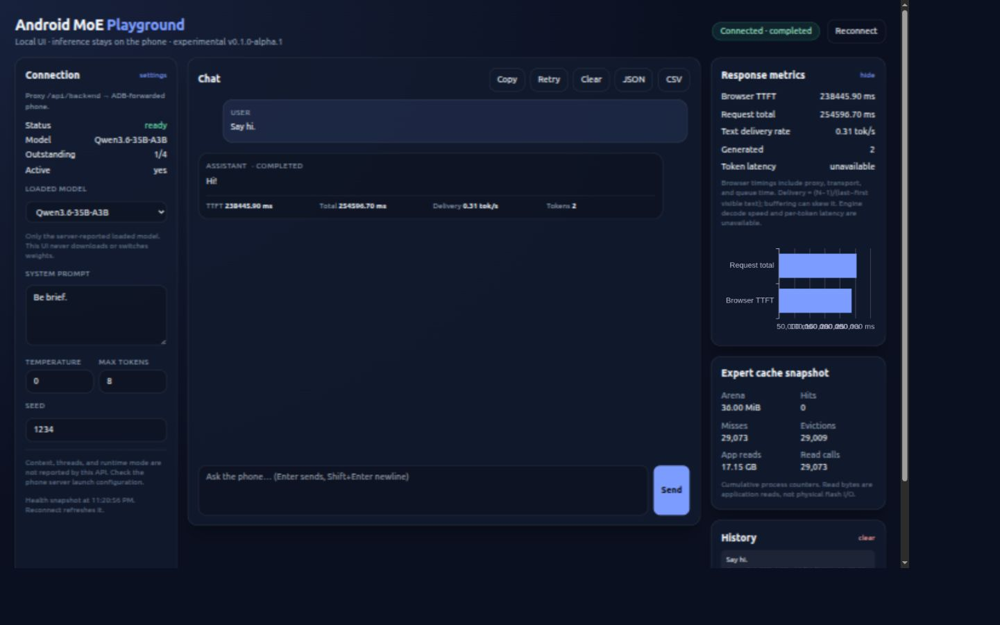
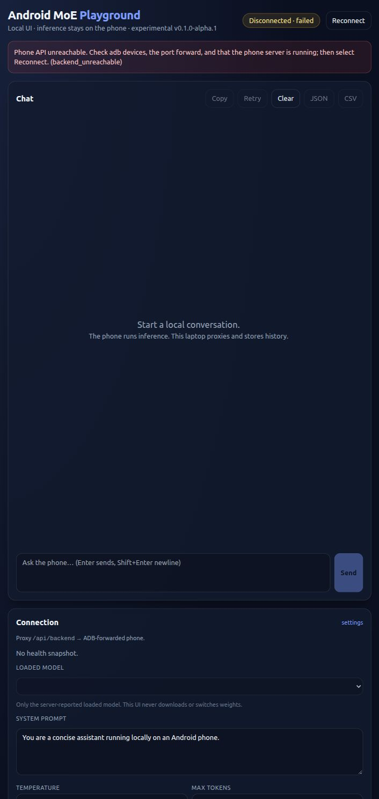

# Playground connectivity verification — 2026-10-21

Scope: local UI polish and connectivity checks on `web-playground`, starting from `57c04d6`, with the documented working-tree changes. This is a smoke test, not a controlled latency or throughput benchmark. No model, native engine, or phone launch settings were changed.

## Environment and connection

- Laptop: Node.js 22.23.2, npm 10.9.8; SvelteKit adapter-node server bound to laptop loopback port 5173.
- Target: the existing Android phone server, reached through wireless ADB and `adb forward tcp:8080 tcp:8080`. Network identifiers and detailed device logs are excluded.
- Direct and same-origin proxied `GET /health` returned `ready`. `GET /v1/models` listed `Qwen3.6-35B-A3B`; the UI selected that API-reported model.
- The health snapshot reported a 37,748,736-byte (36 MiB) expert arena and 64 slots. These are cumulative/snapshot observations, not request memory or evidence of a hard process memory cap.

## Retained observations

1. Initially no ADB phone was connected. The original proxy returned HTTP 500. After the user enabled wireless debugging, the advertised ADB service connected and the existing API became reachable.
2. The first development-server browser attempt used `Say hi.`, the default system message, temperature 0, seed 1234, and max tokens 8. Development reloads interrupted the browser session. Its response, TTFT, and completion result were not recovered; it is not counted as a successful generation. The server's earlier active admission subsequently drained.
3. The final browser attempt uses the built UI, `Say hi.`, system `Be brief.`, temperature 0, seed 1234, and max tokens 8. It completed with `Hi!`, finish reason `stop`, and 2 backend-reported completion tokens. Browser TTFT was 238,445.90 ms; total duration was 254,596.70 ms. The browser delivery estimate was 0.310 tok/s, not native decode throughput. There was a previous request draining when this attempt was sent, so queue time may contribute; this is not an isolated inference timing. The [synthetic conversation export](phone-chat.json) retains the exact browser values. No native request timing was supplied (`backend_telemetry: null`).
4. A separate temporary UI pointed at an unused loopback backend port, without changing the phone forward. Both the proxy and browser produced the actionable HTTP 502 `backend_unreachable` error. The model list and Send control were disabled. The temporary server was stopped afterward.
5. Responsive layout was inspected at browser-reported widths of 1,455 CSS pixels (three columns) and 391 CSS pixels (single column, chat first), with no document-level horizontal overflow. The empty timing chart displayed a completion prompt and no invented zero-valued measurements.

## Automated checks

| Check | Result |
| --- | --- |
| `npm ci` | Passed; dependency audit warnings retained below |
| `npm run check` | 0 errors, 0 warnings |
| `npm test` | 11 tests passed: 8 client and 3 proxy |
| `npm run build` | Passed; the optional ECharts chunk still triggers the bundler size advisory |
| `.venv/bin/python tools/verify.py` | 12/12 in each of Debug, Release, ASan+UBSan |

The first native verifier invocation failed because the Markdown scanner traversed installed `node_modules` and checked a third-party README's missing source link. The scanner now excludes `node_modules`, matching its existing exclusions for generated builds and third-party sources; the full native verifier then passed. No native inference change was made.

`npm audit` reported 17 advisories: 3 low, 6 moderate, 6 high, and 2 critical. `npm audit fix` made no effective lockfile change. Fixes require dependency migration, including test/build tools; that migration was not mixed into this UI task. This remains an experimental loopback-only setup.

## Measurement limits

Browser TTFT includes proxy, transport, queue, and inference. Browser text delivery rate uses backend completion count and visible text arrival times; buffering and non-visible tokens can distort it. No native decode-speed, batching, token-latency, or cancellation-latency claim follows from these checks. Backend request telemetry and physical phone cancellation qualification remain open.

Existing `chat-ui-conversation.png` evidence used a host fixture. It remains historical host-fixture evidence and is not relabelled as phone inference.

## Captured UI evidence

This capture shows the actual phone response and browser timing chart. Health/cache values are the explicitly timestamped earlier snapshot; they are not live request counters. The screenshot/export was saved on 2026-10-22 after the 2026-10-21 request completed. A final reload on 2026-10-22 confirmed the current API was still ready, no generation was active, and the saved conversation appeared in IndexedDB history. The chart axis was subsequently changed to seconds to avoid crowded millisecond tick labels; the capture retains its original appearance.

The offline screenshot uses an intentionally unused loopback API port; it is a failure-path test, not a phone inference run.
