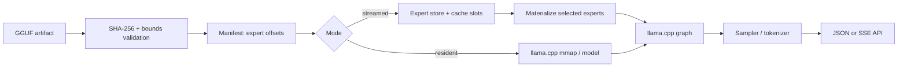
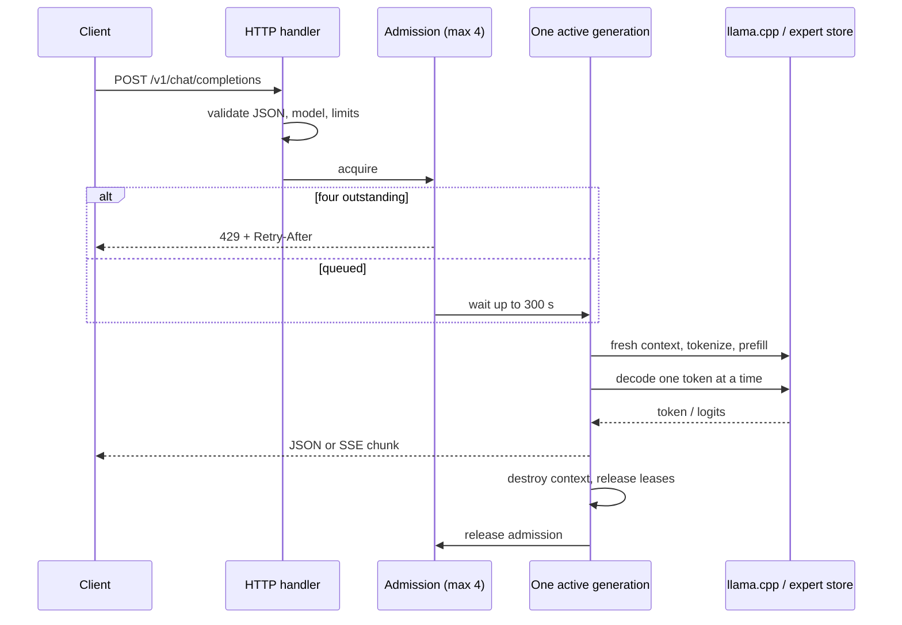

# Android MoE Engine

**Status: experimental Android ARM64 CPU inference prototype.** This is not a
reference-qualified engine, a hard-memory-capped runtime, or a production
serving system. The released version is **v0.1.0-alpha.1**.

This project runs GGUF language models on an Android phone CPU. It keeps the
pinned llama.cpp backend for tokenization, template application, attention,
recurrent state, routing, and quantization kernels. The project adds artifact
verification, manifests, storage-backed expert streaming, bounded admission,
and an OpenAI-compatible text API.

## Two execution modes

| Mode | Weights | Intended use |
| --- | --- | --- |
| Resident | Backend-owned mapped/resident model | Fast baseline and small models |
| Streamed | Non-expert weights resident; expert tensors materialized from the verified artifact into a bounded arena | Models larger than available RAM |

Streaming does **not** mean every expert is resident, and the arena is **not** a
hard process-memory cap. See [Models and measurements](models.md) and
[Troubleshooting](troubleshooting.md).

## What is verified

- The artifact can be hashed fully and its tensor extents, strides,
  quantization blocks, and file bounds validated before use.
- Every routed expert selected by the native backend is consumed; top-k is not
  reduced or replaced.
- Small complete fixtures exercise resident, streamed, and broken-adapter
  paths with exact comparison gates.
- The native server exposes `/health`, `/v1/models`, and
  `/v1/chat/completions` with JSON and SSE.

## What is not claimed

- Real-35B pristine reference parity is **blocked**.
- Continuous batching is **not implemented**. There is one active generation.
- The request queue is bounded, but strict FIFO ordering is **not guaranteed**
  by the current condition-variable implementation.
- Cancellation is not prompt in every phase; recovery is tested separately.
- The `--arena-mib` limit is not a hard cap on total process memory.

See [Overview](#request-lifecycle), [API examples](api.md), and
[remaining limitations](troubleshooting.md).

## Request lifecycle

The request owns cancellation and deadline state. Cleanup order is:
stop emission, drain the synchronous backend call, destroy the fresh context,
release expert leases, publish health data, then release admission. A watcher
that only signals cancellation cannot free backend resources.

**HTTP admission:** four outstanding requests including the active one; excess
requests receive HTTP 429 with `Retry-After`. Queue wait limit: 300 seconds.
Active execution limit: 300 seconds from admission. The HTTP write timeout is
10 seconds.

### Expert-cache slots vs client requests

The default `--slots 64` is an **expert-cache slot count**, not 64 concurrent
clients. One generation is active at a time. The 35B reference configuration
used 64 cache slots and 256 MiB arena; those are storage/materialization
parameters.

### Health

`GET /health` returns model status, live queue counters, and the last
published streaming snapshot. During an active request, streaming cache/read
counters are the last completed snapshot; they are not live cache walks.
