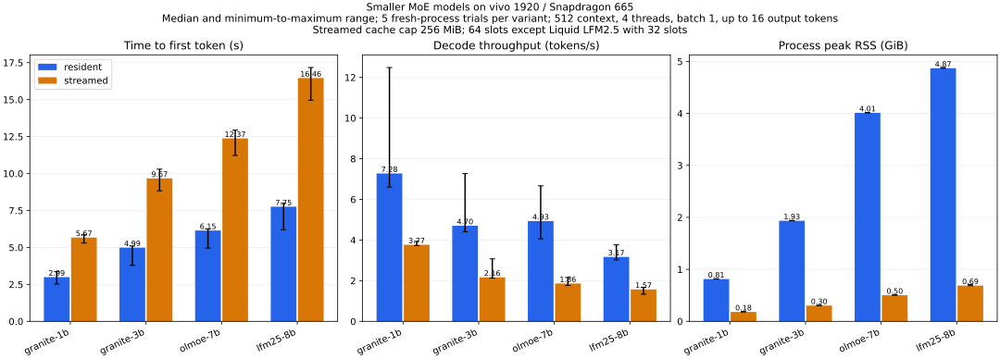

# Models and measurements

## Small-model campaign (harness, not HTTP API)

The measurements below come from
[`docs/SMALLER_MOE_RESULTS.md`](https://github.com/Ananthzeke/android-moe-engine/blob/main/docs/SMALLER_MOE_RESULTS.md)
and the published aggregates in
[`evidence/small-moe/20261021/`](https://github.com/Ananthzeke/android-moe-engine/tree/main/evidence/small-moe/20261021).
They are **harness** results, not OpenAI API qualification.

All four Q4_K_M artifacts completed resident and streamed CPU inference on the
vivo 1920 / Snapdragon 665 / 8 GB / Android 12 target. The campaign reported 28
matched pairs with identical prompt IDs, output IDs, text, and finish reasons,
and eight captured-logit comparisons matching byte-for-byte. This is not a
quality score, not general model support, and not a pristine-upstream parity
claim.

| Model | Mode | TTFT (s) | Decode (tok/s) | Peak RSS (GiB) |
| --- | --- | ---: | ---: | ---: |
| granite-1b | resident | 2.99 [2.52, 3.36] | 7.28 [6.61, 12.49] | 0.81 |
| granite-1b | streamed | 5.67 [5.30, 5.86] | 3.77 [3.73, 3.93] | 0.18 |
| granite-3b | resident | 4.99 [3.79, 5.10] | 4.70 [4.40, 7.27] | 1.93 |
| granite-3b | streamed | 9.67 [8.83, 10.29] | 2.16 [2.13, 3.07] | 0.30 |
| olmoe-7b | resident | 6.15 [4.96, 6.25] | 4.93 [4.06, 6.67] | 4.01 |
| olmoe-7b | streamed | 12.37 [11.22, 12.94] | 1.86 [1.77, 2.16] | 0.50 |
| lfm25-8b | resident | 7.75 [6.20, 7.99] | 3.17 [3.02, 3.76] | 4.87 |
| lfm25-8b | streamed | 16.46 [14.96, 17.17] | 1.57 [1.33, 1.68] | 0.69 |

Values are median [minimum, maximum], five measured trials per mode, excluding
warmup and distinct-prompt trials. Context 512, four requested CPU threads,
matched one-token prefill microbatches, greedy sampling, seed 1234, up to 16
generated tokens.

### Exact artifacts

| ID | Repository | Revision | File | SHA-256 |
| --- | --- | --- | --- | --- |
| granite-1b | bartowski/granite-3.1-1b-a400m-instruct-GGUF | `940d2e1f9f65330615c7c8e980e6c5ac73d3360c` | `granite-3.1-1b-a400m-instruct-Q4_K_M.gguf` | `3a2ec1c2a78cb29d901e29bbf5162dcd03381e13803d2cbdcff838d4d08142eb` |
| granite-3b | bartowski/granite-3.1-3b-a800m-instruct-GGUF | `be9a36f042806cb586bc65556c527079782b78e0` | `granite-3.1-3b-a800m-instruct-Q4_K_M.gguf` | `48e0edcd578fd4462f26127f04c651d0e650741110185297741089aea01a82b3` |
| olmoe-7b | allenai/OLMoE-1B-7B-0125-Instruct-GGUF | `2ac1d27317927518c9ef7bd99f91f3f1e4ee288d` | `OLMoE-1B-7B-0125-Instruct-Q4_K_M.gguf` | `4ddc0e53159ed512b8dd67914a66e27bc618f694672ba43a9a0454eabd9c684f` |
| lfm25-8b | LiquidAI/LFM2.5-8B-A1B-GGUF | `49c14831707011e64d70b2ebd8462ba08d608434` | `LFM2.5-8B-A1B-Q4_K_M.gguf` | `4923ec14f06b968b74d663e5949867d2d9c3bf13a20b8be1a9f9af39989b2bb0` |

Full immutable revisions, sizes, and hashes are in
[`artifacts.json`](https://github.com/Ananthzeke/android-moe-engine/blob/main/evidence/small-moe/20261021/artifacts.json).
The Android harness initially failed to link ARM SHA2; the published campaign
required adding the separately compiled `sha256_arm.o` to the harness Android
link commands. That build-script correction is included on this branch and was
built successfully.

### Liquid 32-slot amendment

Granite and OLMoE used 64 cache slots. Liquid has two expert-size classes:
64 slots require **309.75 MiB**, above the 256 MiB arena; 32 slots require
**154.875 MiB**. Liquid was amended to 32 slots before the run. No failed
64-slot Liquid inference was run. The declared 1,048,576 KiB system-memory floor
was unchanged.

### Measurement conditions

OS caches were uncontrolled and pre-run hashing warmed file cache; these are not
cold-storage measurements. CPU placement, frequency, thermal state, and
background applications were uncontrolled. Host downloads overlapped the
Granite trials. RSS is process-lifetime VmHWM, not a hard cap. Application read
bytes may be served by page cache, not physical flash. Cross-model timings are
characterizations of these requests, not rankings.

## 35B model (separate, experimental)

The target is **Qwen3.6-35B-A3B Q4_K_M**, 20,419,565,568 bytes, SHA-256
`671e47e0ec53c665d048b98c3ecbfd5236b5ca9c3e02ed19fc8f81f7b85140c7`.
It runs through the native HTTP server with native top-8 routing and all 40
layers. Short API responses were produced.

| Metric | 35B phone observation |
| --- | ---: |
| Full SHA-256, scalar | 403.728 s |
| Full SHA-256, ARMv8 SHA2 | 173.759 s; later 339.631 s |
| Short 2-token request | 46.6 s total |
| 32-token request | 105 s total |
| Effective 32-token throughput | ~0.30 tok/s |
| Expert reads, 32-token request | 31,032,999,936 bytes |
| RSS / HWM / PSS | 2,000,584 / 2,109,232 / 2,083,974 KiB |
| Arena | 37,748,736 bytes |

**Not established:** real-35B pristine reference parity, logits/token ID
equality, long-context, two-hour mixed load, continuous batching, or an HTTP
queue-inclusive benchmark. Do not use the 35B short response as reference
correctness evidence. See
[`docs/RELEASE_REPORT_35B.md`](https://github.com/Ananthzeke/android-moe-engine/blob/main/docs/RELEASE_REPORT_35B.md).
